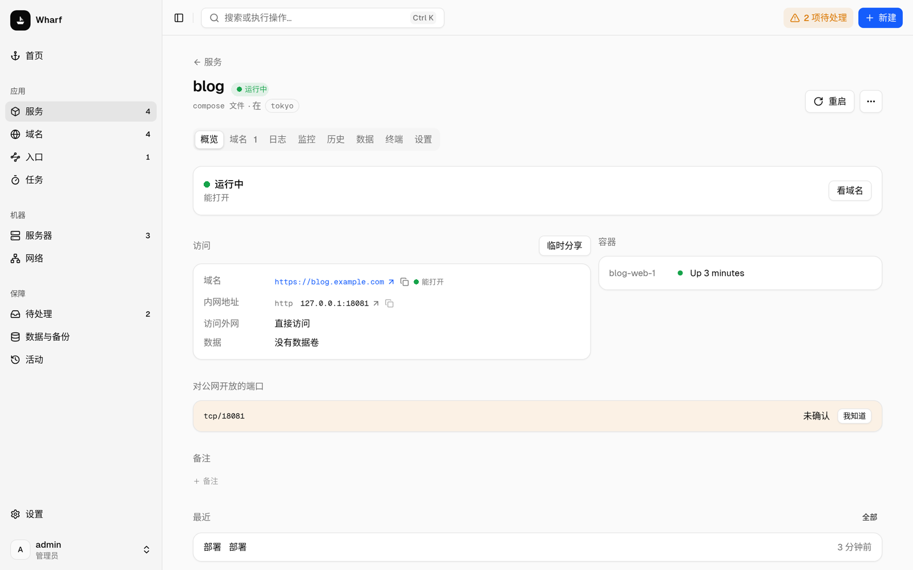
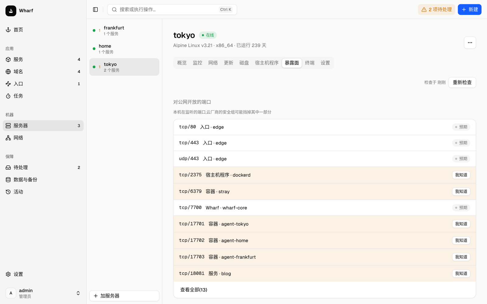

# Wharf

一个人用的多服务器管理系统：把几台机器上的服务、域名、数据放在一处管理。人用页面查看和部署，AI 用 `wharf` 命令行操作。

> 状态：个人项目，作者在自己的几台机器上日常使用。版本号还是 0.1，没有稳定性承诺；界面、命令行和文档目前只有中文。

四个核心概念：

- **服务器**：每台机器跑一个 agent，主动连接控制面；
- **服务**：一个服务就是一个 compose 项目，来源可以是镜像、compose 文件、git 仓库或本机代码目录；
- **网关**：公网入口，支持 Caddy 和 Cloudflare 隧道；
- **路由**：域名 → 网关 → 服务，DNS、证书、上游地址自动处理。

<picture>
  <source media="(prefers-color-scheme: dark)" srcset="docs/screenshots/overview-dark.png">
  
</picture>


## 能做什么

- **部署**：镜像、compose、git 仓库、本机代码（Python、Node、Go、静态站点自动识别，有 Dockerfile 就用）；部署历史、回滚、固定镜像 digest 和 commit；
- **域名**：自动建 DNS 记录、签证书；网关和服务不在一台机器时自动选直连或反向隧道；登录保护、备用入口；
- **Cloudflare Workers / Pages**：导入、发布、绑定域名；
- **数据**：服务迁移到另一台机器、restic 备份和恢复、数据卷文件浏览、控制面自身备份；
- **组网**：Tailscale 接入、连通性和链路质量、服务之间按名字引用、外网代理；
- **运维**：容器终端和宿主机终端、日志、资源和请求曲线、域名逐层诊断（`wharf doctor`）、定时任务、告警和飞书通知、机器基线、系统更新、一键升级；
- **给 AI 用**：所有命令支持 `--json`，修改先 plan 再 apply，高风险项要显式确认，token 按权限点授权。

### 截图

服务详情：访问地址、容器、对公网开放的端口、最近操作。

<picture>
  <source media="(prefers-color-scheme: dark)" srcset="docs/screenshots/service-dark.png">
  
</picture>

域名：每个域名指向哪个服务、经哪个入口、是否加登录保护、证书到期时间。

<picture>
  <source media="(prefers-color-scheme: dark)" srcset="docs/screenshots/domains-dark.png">
  
</picture>

暴露面：每台服务器对公网开放的端口和归属，没预期到的端口会进待处理。

<picture>
  <source media="(prefers-color-scheme: dark)" srcset="docs/screenshots/exposure-dark.png">
  
</picture>


## 适合谁

- 适合：一个人管几台 Linux 服务器（家里的机器、VPS），服务都跑在 Docker 里，域名托管在 Cloudflare；
- 不适合：多人协作和细粒度权限（页面只有一个管理员账号）、Kubernetes、非 Docker 的部署方式。

运行要求：

- 控制面和 agent 都以 Docker 容器运行，机器上要有 Docker；加入服务器时如果没有 Docker，脚本可以在 apt 系发行版上帮你装 `docker.io`（会先询问）；
- 用域名需要一个 Cloudflare 账号（DNS 托管在 Cloudflare）；
- Caddy 网关要求所在机器有公网 IP 并开放 80/443；没有公网 IP 时可以用 Cloudflare 隧道网关。

## 快速开始

### 1. 启动控制面

在一台有 Docker 的机器上：

```bash
docker run -d --name wharf-core --restart unless-stopped --network host \
  -v /var/lib/wharf-core:/var/lib/wharf-core \
  ghcr.io/wmgx/wharf-core:latest
```

打开 `http://<这台机器>:7700`，第一次进入要填初始化码并设置管理员账号：

```bash
docker exec wharf-core cat /var/lib/wharf-core/setup.code
```

常用环境变量：

| 变量 | 说明 |
|---|---|
| `WHARF_LISTEN` | 监听地址，默认 `0.0.0.0:7700` |
| `WHARF_PUBLIC_URL` | agent 连接控制面用的地址；不设置时用请求里的 Host |
| `WHARF_AGENT_IMAGE` | 加入命令里用的 agent 镜像，国内机器可以换成镜像站地址 |

忘记密码：`docker exec -it wharf-core wharf-core reset-password`。

### 2. 加服务器

在页面上点"新建 → 加服务器"，把给出的一条命令复制到目标机器上执行。agent 上线后会自动上报内网地址、公网 IP 和磁盘余量。

### 3. 部署服务、加域名

在页面上点"新建 → 部署服务"，选来源和服务器，可以顺手填域名。要用域名，先在"设置 → 厂商账号"里加一个 Cloudflare 账号（token 需要 Zone DNS 编辑、Zone 读取、Cloudflare Tunnel 编辑权限）。

### 4. 接入 CLI 和 AI

在"设置 → 访问令牌"里点"接入 CLI / AI"，新建 token，然后在你的电脑上执行一条命令，按提示粘贴 token 即可完成安装和登录：

```bash
curl -fsSL https://<控制面地址>/cli.sh | sh -s -- https://<控制面地址>
```

CLI 支持 Linux 和 macOS（amd64、arm64），版本和控制面一致；重复执行就是更新。

**给 AI 用**：脚本会顺带把 Skill 装到 `~/.agents/skills/wharf/`（Codex 等会读这个目录）；本机装了 Claude Code（有 `~/.claude`）时，再软链到 `~/.claude/skills/wharf/`。重复执行安装命令就会更新 Skill。其他工具可以从 `https://<控制面地址>/skill.md` 下载，内容和仓库里的 [`skill/SKILL.md`](skill/SKILL.md) 一致。

## 命令行

```bash
wharf status                                   # 总览
wharf deploy ./app --port http=8000 --apply    # 部署本机代码目录
wharf service deploy who --image traefik/whoami --port http=80 --apply
wharf route add who.example.com --service who --apply
wharf plan                                     # 只检查漂移
wharf apply <plan_id> --confirm <address>      # 执行计划，确认高风险项
wharf doctor who.example.com                   # 逐层诊断一个域名
wharf export > fleet.toml                      # 导出期望状态
wharf schema                                   # 字段说明（JSON Schema）
```

- 所有命令支持 `--json`，错误格式统一为 `{ code, message, hint, suggest }`；
- 退出码：`0` 成功，`1` 出错，`2` 需要确认，`3` 计划已过期，`4` 部分失败；
- 输出里不会出现密钥明文。

## 组成

| 程序 | 说明 |
|---|---|
| `wharf-core` | 控制面（axum + SQLite），提供 API 和页面，负责 plan / apply |
| `wharf-agent` | 每台服务器一个，主动连接控制面，执行 compose、网关、备份等操作 |
| `wharf` | 命令行 |

agent 和 CLI 到控制面的通道在应用层加密，不依赖 TLS。

## 安全须知

- 控制面能在所有服务器上起容器、改网关配置，开了宿主机终端或命令执行时还能直接操作宿主机，权限相当于这些机器的 root。建议只在内网或 Tailscale 里访问；要放到公网，经网关给它配 HTTPS 域名；
- agent 连接控制面时，公网地址必须用 `https://`，控制面会拒绝生成明文公网地址的加入命令；
- 页面登录有失败锁定，可以在"设置 → 登录与安全"里开两步验证；
- 访问令牌按权限点授权（查看、预览、执行、确认高风险、宿主机、管理），给 AI 的令牌不要带"确认高风险"和"管理"。

发现安全问题请见 [SECURITY.md](SECURITY.md)。

## 开发

需要 Rust（版本见 `deploy/Dockerfile`）和 Node 22。

```bash
# 控制面：数据放在 ./data，监听 7700
cargo run -p wharf-core

# 页面：开发服务器把 /api 代理到控制面（默认 http://127.0.0.1:7700）
cd web && npm ci && npm run dev
```

不先构建页面时，控制面二进制里不含页面，访问会得到提示，API 和 CLI 正常可用。

提交前的检查（和 CI 一致）：

```bash
cargo fmt --check
cargo clippy --all-targets -- -D warnings
cargo test
cd web && npx tsc --noEmit

# 改了 crates/api-types 里给页面用的类型后，重新生成 web/src/types.gen.ts
cargo run -q -p wharf-cli -- schema web | node web/scripts/gen-types.mjs > web/src/types.gen.ts

scripts/build-images.sh    # 构建 wharf-core / wharf-agent 镜像
scripts/e2e.sh             # 在有 Docker 的机器上做端到端验证
```

欢迎提 issue。这是个人项目，功能取舍以作者自己的使用为准，较大的改动请先开 issue 讨论。

## 协议

[Apache-2.0](LICENSE)
